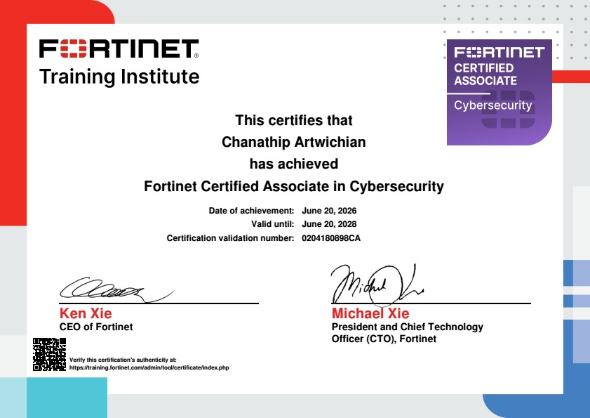

# Fortinet Certified Associate in Cybersecurity

[← Back to Portfolio](../README.md)

## Certificate

## About This Certificate

This certification demonstrates foundational knowledge in cybersecurity and security concepts associated with the Fortinet ecosystem.

## Topics

- Cybersecurity fundamentals
- Network security concepts
- Security threats and protection principles
- Introduction to Fortinet security solutions